<div align="center">

# ⏳ Kairos — Campus Skill Exchange

### Teach what you know. Learn what you don't. Pay in time, not money.

**Teach Python for an hour, earn an hour. Spend it learning guitar from the student down the hall.**
Kairos is an Android app where one minute of teaching earns one time credit and one minute of learning spends one.


[](https://github.com/nishantparwani/Kairos/releases/latest)

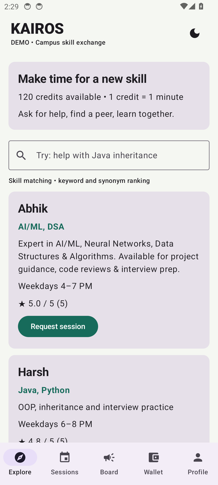 &nbsp; 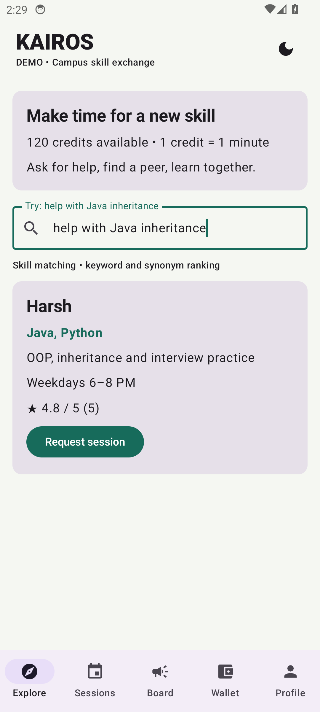 &nbsp; 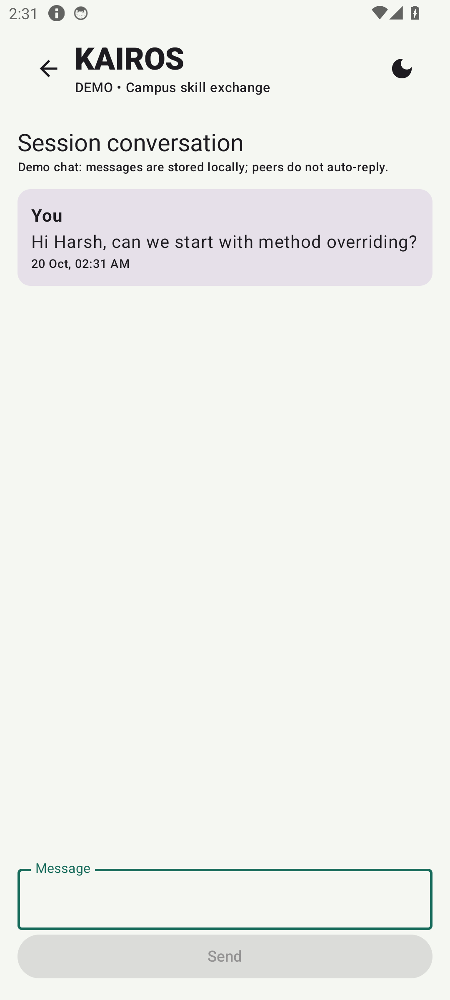

</div>

Built with Kotlin, Jetpack Compose (Material 3) and a Firebase backend (Auth, Firestore, Storage, Cloud Messaging, Cloud Functions), with Razorpay for credit-pack purchases.

## Download

Install the demo APK on any Android 8.0+ phone: [**Kairos demo v1.0 (Releases)**](https://github.com/nishantparwani/Kairos/releases/latest). It needs no account or internet setup; it starts with sample students and 120 credits, and no money is charged.

## Screenshots

Taken from the `demoDebug` build running on an Android 14 (API 34) emulator.

| Explore | Skill matching | Booking |
|---|---|---|
|  |  | 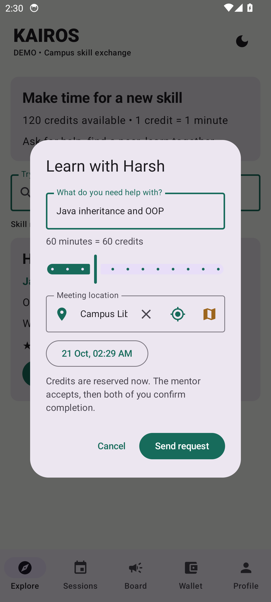 |
| **Session requested** | **Mentor accepted** | **Session chat** |
| 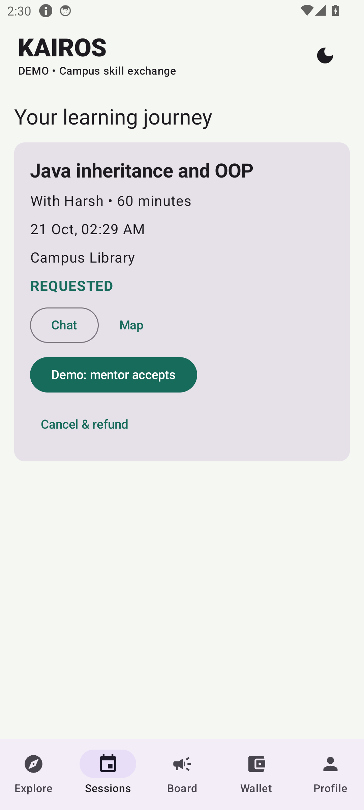 | 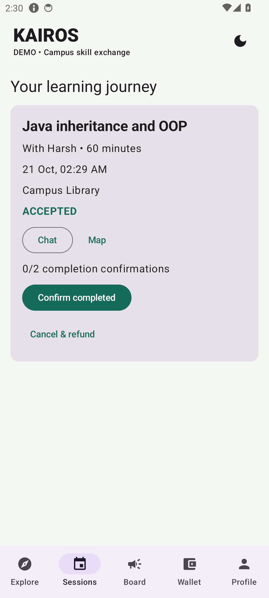 |  |
| **Completed + notification** | **Rated** | **Notice board** |
| 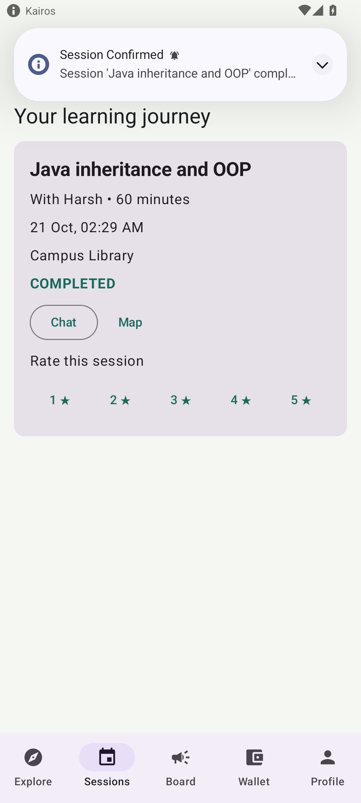 | 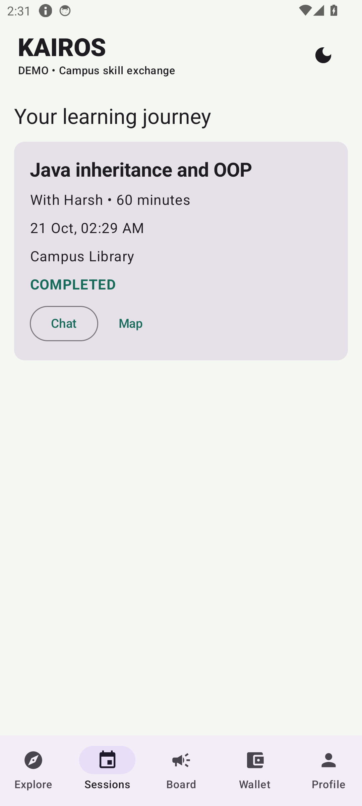 | 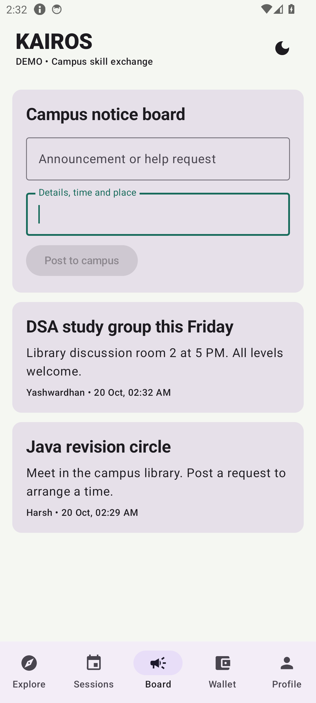 |
| **Wallet and ledger** | **Profile** | **Dark mode** |
| 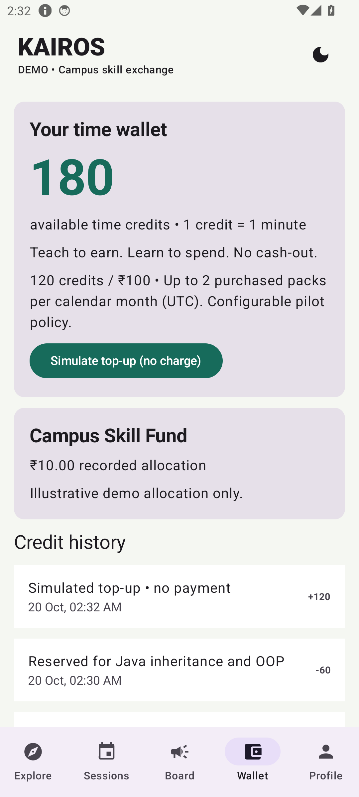 | 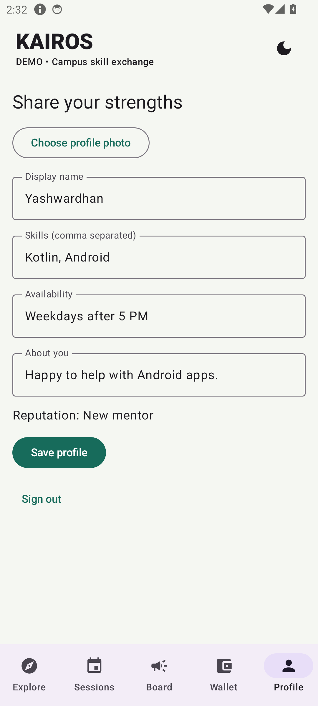 | 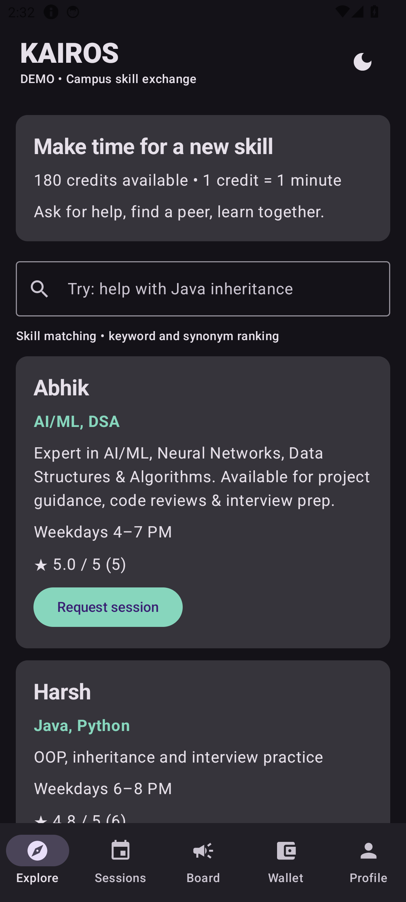 |

## Features

| Feature | How it works |
|---|---|
| Student verification | Firebase email/password sign-up, email verification, server-side exact college-domain allow-list |
| Profiles | Name, skills, availability, bio, photo, rating |
| Skill matching | Rule-based keyword + synonym ranking (`SkillMatcher`), not an AI model |
| Time credits | 120-credit joining bonus, credits held at booking, refund on cancel, paid to mentor after both confirm |
| Sessions | Request → mentor accepts → both confirm completion → rate 1–5 stars |
| Chat | Participant-only chat per session |
| Notice board | Campus announcements and help requests |
| Wallet | Balance, credit ledger, 120 credits for ₹100 (max 2 packs a month), 10% recorded for a campus fund |
| Meeting location | Campus places, place search and open in Maps |
| Notifications | FCM push in live mode, local notifications for session updates |

## Architecture

```
Compose screens  →  KairosViewModel (StateFlow)  →  Repository
                                                     ├─ DemoRepository      (demo flavor, local data)
                                                     └─ FirebaseRepository  (live flavor)
                                                            ↓
                              Firebase Auth · Firestore · Storage · FCM · Cloud Functions → Razorpay
```

The client never writes balances, session states or ratings. Firestore rules deny those writes and only Cloud Functions change them inside transactions. See [docs/ARCHITECTURE.md](docs/ARCHITECTURE.md).

## Run it

1. Open the project folder in Android Studio and let Gradle sync (JDK 17–25; SDK 35).
2. Build Variant → **demoDebug** (no Firebase account needed; sample students and 120 credits).
3. Run on an emulator or phone with Android 8.0 (API 26) or newer.

Terminal:

```sh
./gradlew :app:assembleDemoDebug :app:testDemoDebugUnitTest
cd functions && npm ci && npm test
```

The live flavor needs your own `app/google-services.json` and a deployed backend: see [docs/FIREBASE_SETUP.md](docs/FIREBASE_SETUP.md).

## Tests

- Android unit tests: 4 passed (`SkillMatcherTest`).
- Backend tests: 5 passed (`functions/test/policy.test.js`).
- Demo APK and live flavor both build.

Details: [docs/TEST_RESULTS.md](docs/TEST_RESULTS.md) and the live acceptance checklist in [docs/TESTING.md](docs/TESTING.md).

## Team

| Member | Area | Files |
|---|---|---|
| Nishant | Architecture, build, app core, README | Gradle files, `AndroidManifest.xml`, `res/`, `MainActivity.kt`, `KairosViewModel.kt`, `Repository.kt`, `docs/ARCHITECTURE.md`, `screenshots/` |
| Harsh | UI screens and matching | `Screens.kt`, `Models.kt`, `SkillMatcherTest.kt` |
| Yash | Backend and database | `functions/`, `firestore.rules`, `storage.rules`, `firebase.json`, `docs/FIREBASE_SETUP.md` |
| Abhik | Integration and testing | `FirebaseRepository.kt`, `KairosMessagingService.kt`, `LocationSearch.kt`, `docs/TESTING.md`, `docs/TEST_RESULTS.md` |

## Limitations

Academic MVP. Not deployed to production and no real payments taken. Not built yet: embedded maps, admin screens, disputes, automatic booking expiry, rate limits and App Check. No automatic payout from the campus fund.
